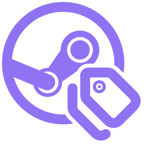

<p align="center">
  
</p>

# Tag Kit for Steam

A browser extension for Chromium-based browsers and Firefox, and a userscript for Tampermonkey and Violentmonkey, that tag items on the Steam store with what Steam's own store data says about them: AI Generated Content Disclosure, anti-cheat (Kernel Level Anti-Cheat first), 3rd-party DRM, 3rd-Party Account, 3rd-party EULA and PvP.

> Status: in development. Nothing is released yet, and the install links below are placeholders.

The extension only reads what Steam's store data and developers report there, and sends no reports anywhere.

## Why

Steam Next Fest is, I kid you not, one of my favorite times of the year. I try the demos but never get to play as many as I'd like, and I still browse every corner of the fest and wishlist a bunch of games. Too often a game looks great until I find out it leans heavily on generative AI for its creative work, from gameplay design to art and music. For me personally, that is where I draw the line: creative work done with AI is a hard stop.

I couldn't find an extension that covered every corner of the store and let me preview and review what a developer reported right from the list, without opening the game's page. So I built one. I know this is "querer ponerle puertas al campo" (trying to put doors on an open field), but it's the best I can do, and more importantly, it's fun :)

If you browse the store the same way, I hope you find it useful too.

## What it does

- Tags these kinds of items: AI Generated Content Disclosure, Kernel Level Anti-Cheat and other Anti-Cheat Software, 3rd-party DRM, 3rd-Party Account, 3rd-party EULA and PvP.
- Adds a badge to capsules and rows (search, wishlist, home, tag and category hubs, sale pages such as Next Fest, developer and publisher pages, the discovery queue, search suggestions) for items that carry one of those tags.
- Shows a non-blocking banner on the app page that quotes the developer's AI report verbatim.
- Optionally dims or hides those items in lists. This is off by default.
- Lets you ignore a game you consider a false flag, with a per-game allow-list.

Each tag follows Steam's own words:

- AI Generated Content Disclosure: the developer reported generative AI use. The badge reads "AI use reported".
- Kernel Level Anti-Cheat: the game's anti-cheat runs at the kernel level.
- Anti-Cheat Software: the game uses anti-cheat software.
- 3rd-party DRM: the game uses DRM from a third party.
- 3rd-Party Account: the game needs an account with a third party.
- 3rd-party EULA: the game needs agreement to a third party's EULA.
- PvP: the game has player-versus-player play.

The AI badge does not say a game uses AI, and the absence of a badge does not mean a game is AI-free: the report comes from the developer, and the badge marks what developers chose to report.

### On the store


In search results, rows of games whose developers reported AI use carry the badge after the name.


On a game's page, a banner above the purchase box quotes the developer's report in their own words. The page's DLC rows get badges too. "Ignore this game" stops the badges and the banner for that game in this extension and does not touch Steam's own Ignore button.


Hovering or tabbing to a badge opens a panel in the style of Steam's game hover, with the developer's own text and any AI service they named.


Sale pages such as Next Fest, tag and category hubs and the home page get a compact "AI use reported" badge on the game's image.

### Settings


The options page turns badges and the banner on or off, sets how lists treat those games, picks the language (automatic follows the store page), and lists the games you ignored, each with "Stop ignoring".


With the list filter on Dim, badged games fade in lists and come back on hover. Hide removes them from lists. Show, the default, leaves lists as they are.


The toolbar popup holds the same switches, the list filter and the games you ignored, with a link to the full options page. The userscript opens the same settings in a dialog from the script manager's menu.

### Known gaps

- In the header's search suggestions on a game's own store page, the suggestion for that same game gets no badge. The banner on the page shows its report.

## Install

- Chrome Web Store: link to follow.
- Firefox Add-ons (AMO): link to follow.
- Userscript: link to follow (Tampermonkey or Violentmonkey).

## Privacy

Nothing is collected. App IDs of the items on the page go, without cookies, only to Valve's own hosts you are already using. See [PRIVACY.md](PRIVACY.md).

## Development

Requirements: [mise](https://mise.jdx.dev) and Git. mise installs every other tool at the pinned version (Node, pnpm, Python, dprint, ruff, mypy, shellcheck, shfmt, actionlint, zizmor, changie, web-ext), and pnpm installs the JavaScript libraries (esbuild, TypeScript, oxlint, vitest) from the lockfile. On Windows, use Git for Windows; see `mise.local.toml.example` for putting Git Bash ahead of WSL's `bash` when running tasks from PowerShell.

```bash
mise trust
mise run setup
```

`setup` installs the tools and the JavaScript dependencies, writes the pre-commit and pre-push Git hooks, and checks the browser paths. Copy `mise.local.toml.example` to `mise.local.toml` (ignored by Git) and set `SAR_GECKO_BIN` and `SAR_GECKO_PROFILE` (Firefox Nightly and a profile dedicated to this project), plus `SAR_CHROMIUM_BIN` and `SAR_CHROMIUM_PROFILE` (Chromium and its own profile).

Main tasks:

- `mise run fmt`: format every file we own (width 100; Markdown is formatted for structure only).
- `mise run lint`, `mise run typecheck`, `mise run test`: oxlint with type-aware rules, ruff, mypy, shellcheck, actionlint and zizmor; TypeScript 7; vitest with happy-dom.
- `mise run build`: build `dist/chromium`, `dist/gecko`, `dist/userscript` and the dev-only `dist/dev`.
- `mise run check`: text, catalog, version and bundle checks on top of the build.
- `mise run ci`: everything CI runs. The pre-push hook runs `prepush`, which is the same without the reproducibility check and `web-ext lint`.
- `mise run dev`: rebuild on change. In another terminal, `mise run run-gecko` (Firefox Nightly only) or `mise run run-chromium` loads the build with auto-reload.
- `mise run package`: write the Chromium and Gecko zips, the userscript and its `.meta.js`, and the source archive for store reviewers to `artifacts/`, then check them.
- `mise run canary`: before a release, check that live Steam still answers in the shape the detectors expect (two requests). It is not part of `ci`.
- `mise run capture-fixtures`: refresh the public test fixtures from the live store.
- `mise run icons`: render the extension icon PNGs in `assets/icons/` from `mark-purple.svg` with headless Chromium (`SAR_CHROMIUM_BIN`).
- `mise run change-new`: add a changelog fragment. A pull request that changes `src/` needs one, unless it carries the `no-changelog-fragment` label.

### Try a build in your browser

For the quick loop, `mise run run-chromium` or `mise run run-gecko` builds, opens the browser with the dedicated profile from `mise.local.toml` and reloads the extension after each rebuild. Run `mise run dev` in another terminal to rebuild on every change.

To test what a release ships, run `mise run package`. It writes these files to `artifacts/`:

- `steam-ai-reporter-chromium-<version>.zip` and `steam-ai-reporter-gecko-<version>.zip`.
- `steam-ai-reporter.user.js` and `steam-ai-reporter.meta.js`.
- `steam-ai-reporter-source-<version>.zip`, the archive for store reviewers.

`<version>` is the `package.json` version, which holds the last release, so a local package carries that number. Load it like this:

- Chromium: open `chrome://extensions`, turn on Developer mode, choose "Load unpacked" and pick `dist/chromium`. Chromium cannot load the zip.
- Firefox Nightly: open `about:debugging#/runtime/this-firefox`, choose "Load Temporary Add-on" and pick the Gecko zip. The browser removes it on restart.
- Userscript: open `artifacts/steam-ai-reporter.user.js` in Tampermonkey or Violentmonkey.

Run `mise run ci` before trusting a package. It adds the reproducibility check and `web-ext lint`.

## Build from source

For store reviewers and anyone who wants to reproduce a release. The build runs on Linux, macOS and Windows; releases are built on Ubuntu 24.04. The source archive in each release (`steam-ai-reporter-source-<version>.zip`) holds everything below needs, including the lockfiles. It leaves out `docs/` apart from `docs/design/tokens.css`, which the build reads.

1. Install mise: `curl https://mise.run | sh` (see [mise's install guide](https://mise.jdx.dev/getting-started.html) for other options).
2. In the source folder, run `mise trust`, then `mise install`. This installs the exact tool versions pinned in `mise.toml` and `mise.lock`.
3. Run `mise run build`. It installs the JavaScript dependencies from `pnpm-lock.yaml` and writes the unminified bundles to `dist/` (`dist/gecko` is the Firefox add-on).

`mise run check-reproducible` builds twice and fails if any output byte differs.

## Releasing

[ADR 0005](docs/adr/0005-release-pipeline.mdx) records the design. Versions are unpadded CalVer: `2026.10.21`, and `2026.10.21.1` for a recut on the same day. The `package.json` version holds the last release, and feature pull requests never edit it.

1. A pull request that changes `src/` adds a changelog fragment with `mise run change-new`.
2. The `release-train` workflow runs at 00:00 UTC or on demand. `gh workflow run release-train.yml -f dry_run=true` reports the version it would cut and opens nothing. A real run opens a batch pull request that bumps the version and writes the changelog, and the pull request merges when the checks pass. With no fragments there is no release.
3. After CI passes on the merged batch commit, the pipeline tags it. `release-nightly` builds once, checks that the build reproduces, and publishes a GitHub prerelease with the five artifacts from `mise run package`. No store is touched. Install the prerelease by hand to test it.
4. To ship, run `gh workflow run release-prod.yml --ref <tag> -f tag=<tag>`. It promotes the prerelease artifacts without a rebuild. The Chrome Web Store and AMO jobs each wait for a reviewer's approval. The last job marks the release as latest, which updates userscript installs.

A recut after a store rejection needs a new `.N` version, because AMO never reuses a version number.

## Prior art and thanks

No code is copied from any of these projects. Their ideas shaped this one, and the work is credited here.

- [AI warning for Steam](https://github.com/seeeeew/aiwarningforsteam) by seeeeew: the low-permission manifest, separate cache lifetimes for positive and negative results, and the idea of an automated check for heading changes.
- [Steam AI Games Indicator](https://github.com/Pierre-Demessence/SteamAIGamesIndicator) by Pierre-Demessence: badging every surface, including wishlist and home capsules, guarding against age gates before trusting a negative, and serial requests with a delay.
- [AI Generated Content Filter for Steam](https://github.com/SoBloxsy/AI-Content-Hider-for-Steam) by SoBloxsy: falling back from hiding to highlighting where hiding breaks a list.
- [Augmented Steam](https://github.com/IsThereAnyDeal/AugmentedSteam): ideas only (handling both classic and React store pages, one module per feature, and the request for a dismissible banner). It is GPL-3.0 licensed, and nothing from it is used in any form.

## How it was built

I built this extension with [Claude Code](https://claude.com/claude-code) and Claude Design. I orchestrated the work and oversaw every decision, with close attention to performance and efficiency, design and testing. The code itself was written with Claude's help, luckily for me. Claude Design kept the design language consistent across the badges, the banner, the hover panel and the settings, small as the app is.

## Not affiliated with Valve

Tag Kit for Steam is an independent project. It is not affiliated with, endorsed by or sponsored by Valve Corporation. Steam and the Steam logo are trademarks of Valve Corporation.

## License

MIT. See [LICENSE](LICENSE). The licenses of the bundled library and of the icon artwork, which derives from Lucide and Simple Icons, are in [THIRD_PARTY_NOTICES.md](THIRD_PARTY_NOTICES.md).
