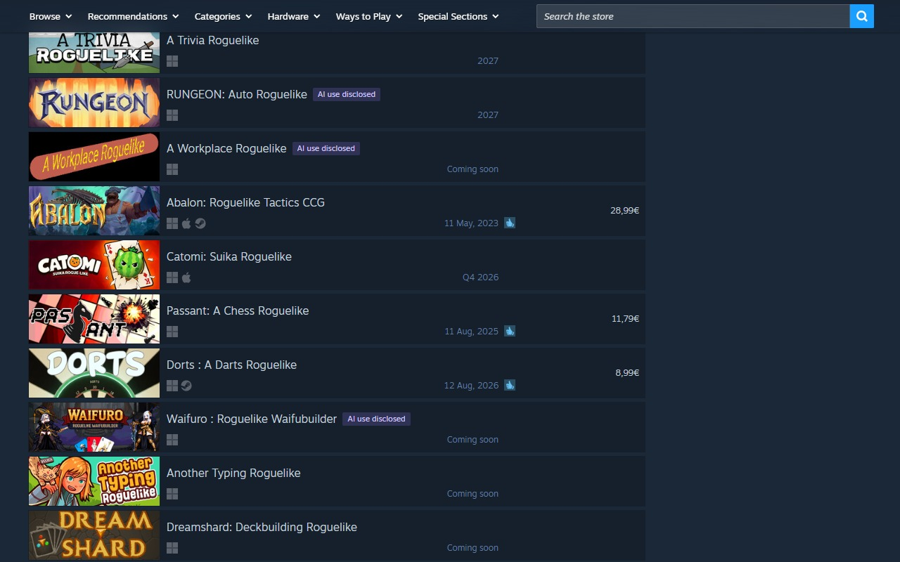
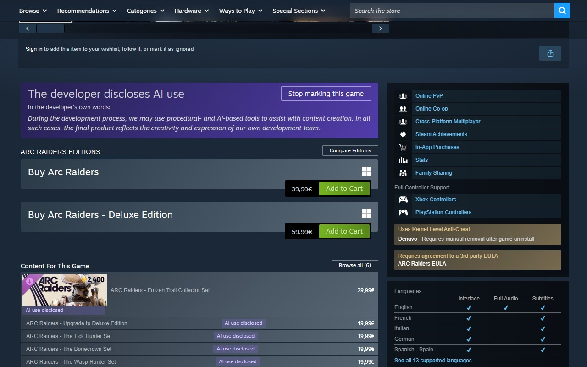
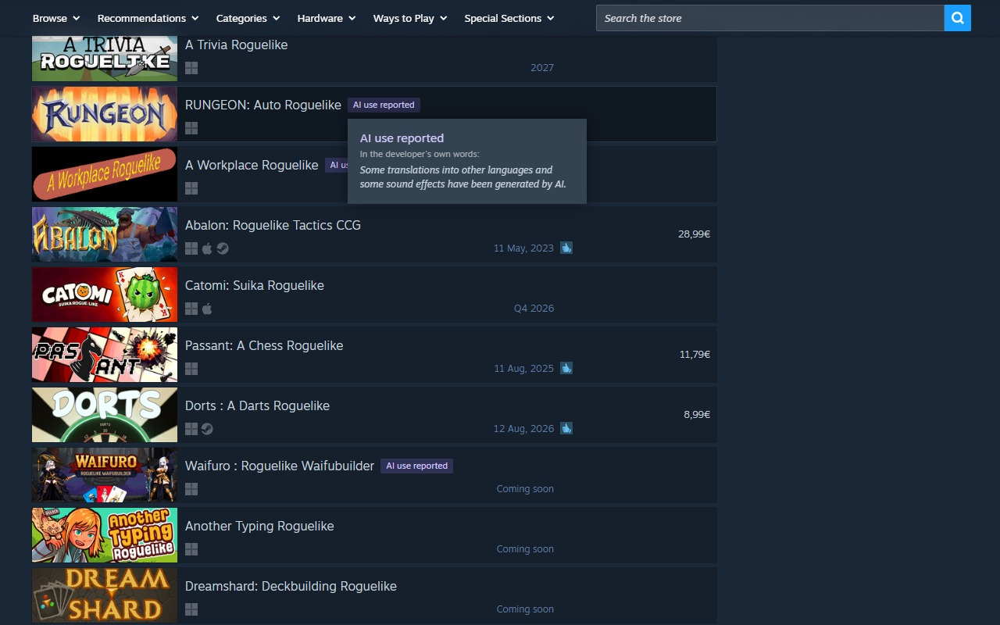
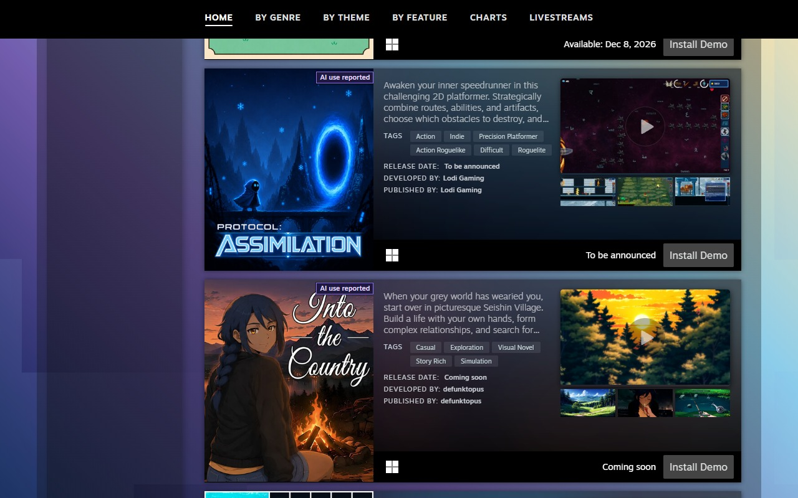
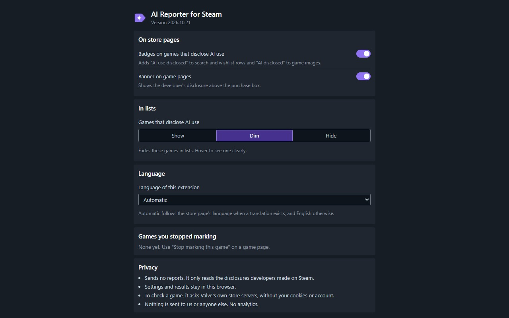
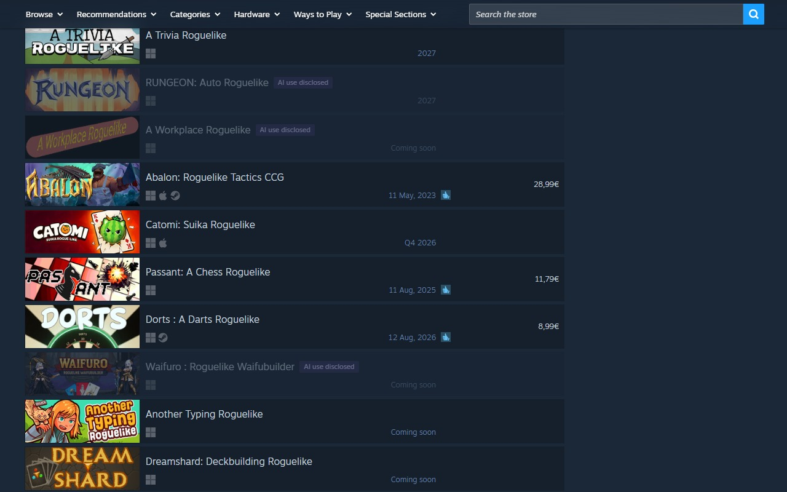
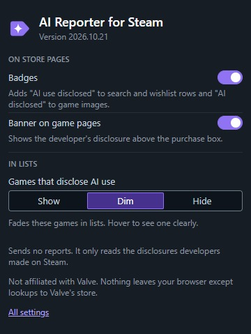

# AI Reporter for Steam

A browser extension (Chrome and Firefox) and a userscript (Tampermonkey and Violentmonkey) that mark items on the Steam store whose developers disclosed generative AI use in Steam's own AI content disclosure.

> Status: in development. Nothing is released yet, and the install links below are placeholders.

The extension only reads Steam's own disclosures and sends no reports anywhere.

## Why

Steam Next Fest is, I kid you not, one of my favorite times of the year. I don't play that much, but I still browse every corner of the fest and wishlist a bunch of games. Too often a game looks great until I find out it leans heavily on generative AI for its creative work, from gameplay design to art and music. For me personally, that is where I draw the line: creative work done with AI is a hard stop.

I couldn't find an extension that covered every corner of the store and let me preview a developer's disclosure right from the list, then review it in full on the game's page. So I built one. I know this is "querer ponerle puertas al campo" (trying to put doors on an open field), but it's the best I can do, and more importantly, it's fun :)

## What it does

- Adds a badge to capsules and rows (search, wishlist, home, tag and category hubs, sale pages such as Next Fest, developer and publisher pages, the discovery queue, search suggestions) for items where the developer filled in the AI disclosure.
- Shows a non-blocking banner on the app page that quotes the developer's disclosure text verbatim.
- Optionally dims or hides disclosing items in lists. This is off by default.
- Lets you ignore a game you consider a false flag, with a per-game allow-list.

The badge says "AI use disclosed". It does not say a game uses AI, and the absence of a badge does not mean a game is AI-free: the disclosure is self-reported by the developer, so it marks what developers chose to disclose and nothing more.

### On the store



In search results, rows of games whose developers disclosed AI use carry the badge after the name.



On a game's page, a banner above the purchase box quotes the developer's disclosure in their own words. "Stop marking this game" adds it to your allow-list. Its DLC rows get badges too.



Hovering or tabbing to a badge opens a panel in the style of Steam's game hover, with the disclosure text and any AI service the developer named.



Sale pages such as Next Fest, tag and category hubs and the home page get a compact "AI disclosed" badge on the game's image.

### Settings



The options page turns badges and the banner on or off, sets how lists treat disclosing games, picks the language (automatic follows the store page), and lists the games you stopped marking, each with "Mark again".



With the list filter on Dim, disclosing games fade in lists and come back on hover. Hide removes them from lists. Show, the default, leaves lists as they are.



The toolbar popup holds the same switches, the list filter and the games you stopped marking, with a link to the full options page. The userscript opens the same settings in a dialog from the script manager's menu.

### Known gaps

- In the header's search suggestions on a game's own store page, the suggestion for that same game gets no badge. The banner on the page already shows its disclosure.

## Install

- Chrome Web Store: link to follow.
- Firefox Add-ons (AMO): link to follow.
- Userscript: link to follow (Tampermonkey or Violentmonkey).

## Privacy

Nothing is collected. App IDs of the items on the page go, without cookies, only to Valve's own hosts you are already using. See [PRIVACY.md](PRIVACY.md).

## Development

Requirements: [mise](https://mise.jdx.dev) and Git. mise installs every other tool at the pinned version (Node, pnpm, Python, dprint, ruff, mypy, shellcheck, shfmt, actionlint, zizmor, changie, web-ext), and pnpm installs the JavaScript libraries (esbuild, TypeScript, oxlint, vitest) from the lockfile. On Windows, use Git for Windows; see `mise.local.toml.example` for putting Git Bash ahead of WSL's `bash` when running tasks from PowerShell.

```bash
mise trust
mise run setup
```

`setup` installs the tools and the JavaScript dependencies, writes the pre-commit and pre-push Git hooks, and checks the browser paths. Copy `mise.local.toml.example` to `mise.local.toml` (ignored by Git) and set `SAR_FIREFOX_BIN` and `SAR_FIREFOX_PROFILE` (Firefox Nightly and a profile dedicated to this project), plus `SAR_CHROME_BIN` and `SAR_CHROME_PROFILE`.

Main tasks:

- `mise run fmt`: format every file we own (width 100; Markdown is formatted for structure only).
- `mise run lint`, `mise run typecheck`, `mise run test`: oxlint with type-aware rules, ruff, mypy, shellcheck, actionlint and zizmor; TypeScript 7; vitest with happy-dom.
- `mise run build`: build `dist/chrome`, `dist/firefox`, `dist/userscript` and the dev-only `dist/dev`.
- `mise run check`: text, catalog, version and bundle checks on top of the build.
- `mise run ci`: everything CI runs. The pre-push hook runs `prepush`, which is the same without the reproducibility check and `web-ext lint`.
- `mise run dev`: rebuild on change. In another terminal, `mise run run-firefox` (Firefox Nightly only) or `mise run run-chrome` loads the build with auto-reload. In Chrome you can also load `dist/chrome` with "Load unpacked".
- `mise run package`: write the Chrome and Firefox zips, the userscript and its `.meta.js`, and the source archive for store reviewers to `artifacts/`, then check them.
- `mise run canary`: before a release, check that live Steam still answers in the shape the detectors expect (two requests). It is not part of `ci`.
- `mise run capture-fixtures`: refresh the public test fixtures from the live store.
- `mise run change-new`: add a changelog fragment. A pull request that changes `src/` needs one, unless it carries the `no-changelog-fragment` label.

## Build from source

For store reviewers and anyone who wants to reproduce a release. The build runs on Linux, macOS and Windows; releases are built on Ubuntu 24.04. The source archive in each release (`steam-ai-reporter-source-<version>.zip`) holds everything below needs, including the lockfiles.

1. Install mise: `curl https://mise.run | sh` (see [mise's install guide](https://mise.jdx.dev/getting-started.html) for other options).
2. In the source folder, run `mise trust`, then `mise install`. This installs the exact tool versions pinned in `mise.toml` and `mise.lock`.
3. Run `mise run build`. It installs the JavaScript dependencies from `pnpm-lock.yaml` and writes the unminified bundles to `dist/` (`dist/firefox` is the Firefox add-on).

`mise run check-reproducible` builds twice and fails if any output byte differs.

## Prior art and thanks

No code is copied from any of these projects. Their ideas shaped this one, and the work is credited here.

- [AI warning for Steam](https://github.com/seeeeew/aiwarningforsteam) by seeeeew: the low-permission manifest, separate cache lifetimes for positive and negative results, and the idea of an automated check for heading changes.
- [Steam AI Games Indicator](https://github.com/Pierre-Demessence/SteamAIGamesIndicator) by Pierre-Demessence: badging every surface, including wishlist and home capsules, guarding against age gates before trusting a negative, and serial requests with a delay.
- [AI Generated Content Filter for Steam](https://github.com/SoBloxsy/AI-Content-Hider-for-Steam) by SoBloxsy: falling back from hiding to highlighting where hiding breaks a list.
- [Augmented Steam](https://github.com/IsThereAnyDeal/AugmentedSteam): ideas only (handling both classic and React store pages, one module per feature, and the request for a dismissible banner). It is GPL-3.0 licensed, and nothing from it is used in any form.

## How it was built

I built this extension with [Claude Code](https://claude.com/claude-code) and Claude Design. I orchestrated the work and oversaw every decision, with close attention to performance and efficiency, design and testing. The code itself was written with Claude's help, luckily for me. Claude Design kept the design language consistent across the badges, the banner, the hover panel and the settings, small as the app is.

## Not affiliated with Valve

AI Reporter for Steam is an independent project. It is not affiliated with, endorsed by or sponsored by Valve Corporation. Steam and the Steam logo are trademarks of Valve Corporation.

## License

MIT. See [LICENSE](LICENSE).
